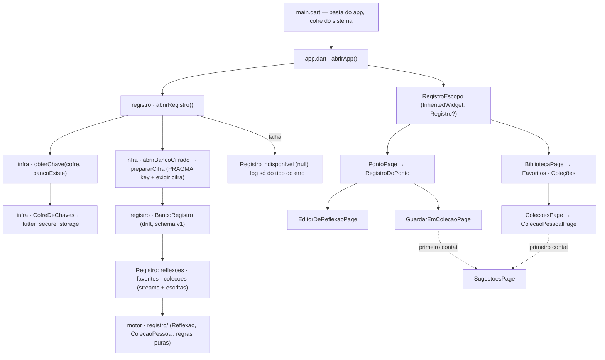

# Guardar (v0.3) — Design

**Spec:** `.specs/features/guardar/spec.md`
**Status:** Approved (delegado — o usuário pediu o fluxo completo sem pausas; ver Rulings no fim)
**Decisões de projeto que esta feature cria:** AD-007 … AD-009 em `.specs/STATE.md` · ADR-002

---

## Architecture Overview

Três camadas, como em `docs/dominios.md`: o **motor** ganha a pasta `registro/` com os tipos do
leitor e as regras puras (texto de reflexão, nome de coleção); o **app** ganha `infra/` (banco
cifrado e guarda da chave) e `registro/` (banco drift, repositórios e telas). As telas leem o
registro por **streams do drift** (`watch()`), então qualquer escrita aparece em toda tela aberta
sem encanamento manual.



Texto equivalente: `main` passa a pasta privada do app e o cofre do sistema; `abrirApp` abre os
livros (v0.2) e o registro. Abrir o registro = obter a chave (gerada e gravada antes do arquivo,
se não houver banco) → abrir o drift cifrado → exigir cifra ativa → forçar a primeira consulta.
Qualquer falha vira "registro indisponível": a leitura segue, e as áreas do registro mostram a
mensagem humana. As telas pegam o `Registro` num `InheritedWidget` e assinam streams.

### Abordagens consideradas (Complex)

| | Abordagem | Prós | Contras |
| --- | --- | --- | --- |
| **A ✅** | Tipos + regras puras no motor; drift + repositórios no app; telas assinam `watch()` via `RegistroEscopo` | Sem pacote de estado (AD-002 continua valendo no espírito); teste sobre SQL real em memória; motor segue sem I/O | Repositórios dependem do drift (aceito: é o banco escolhido no ADR-001) |
| B | Porta de repositório no motor + implementação em memória para testes + drift no app | Motor "completo" | Fake em memória diverge do SQL real (ordem, cascata, transação) — teste que passa no fake e falha no banco |
| C | Riverpod/Bloc para os streams | Padrão conhecido no ecossistema | Dependência e cerimônia para 3 streams; contradiz AD-002 sem ganho concreto |

### Perspective sweep

- **Estrutura** — motor `registro/` (puro), app `infra/` (genérico: cifra, chave) e `registro/`
  (domínio: banco, repositórios, telas). `PontoPage` só embute `RegistroDoPonto`; a regra mora fora.
- **Integração** — streams do drift são a única fonte de verdade das telas; escritas são `Future`.
  Plugin nativo (secure storage) atrás da porta `CofreDeChaves`.
- **Dados** — 5 tabelas, schema v1, chaves estrangeiras ligadas, datas guardadas em UTC como texto
  ISO-8601 (precisão de milissegundos; ordem estável). `PontoId` gravado como string (regra 2).
  `colecoes_pessoais` nunca compartilha tabela ou tipo com `Colecao` (regra 3).
- **Segurança** — arquivo cifrado (sqlite3mc, ChaCha20-Poly1305) desde o primeiro byte; chave de 256
  bits do `Random.secure()`, só no Keystore/Keychain; `PRAGMA key` só aceita hex (sem injeção);
  log de falha leva o **tipo** do erro, nunca a mensagem (a `SqliteException` carrega os parâmetros
  da instrução — o texto da reflexão). Backup desligado (A3).
- **Infra & ops** — codegen do drift (`build_runner`) com o `.g.dart` versionado, para `flutter test`
  rodar sem passo extra; APK debug precisa gerar com o hook do sqlite3mc. Sem CI ainda (v0.1 🗓️).
  Rollback: reverter commits; o arquivo cifrado fica órfão e inofensivo.
- **Domínio** — termo de código `Reflexao` (A1). Sugestões de coleção são copy do app, não regra do
  motor (regra 1: o motor não conhece o conteúdo). Nenhum id de obra novo fora de `livros/`.

**Tensão registrada:** Segurança × UX na chave perdida. Recuperar exigiria senha do leitor (UX pior,
risco de esquecer) ou chave fora do Keystore (segurança pior). Escolha: chave só no Keystore, e a
perda vira "indisponível" sem apagar nada (AC-04) — a única perda real é a do aparelho, já aceita
para a v1.0 (sem conta). Revisitar quando `conta`/exportação (v2.0) entrar.

---

## Code Reuse Analysis

### Existing Components to Leverage

| Component | Location | How to Use |
| --- | --- | --- |
| `PontoId` (parse/toString/==) | `packages/ponto_motor/lib/src/colecao/ponto_id.dart` | Âncora de tudo que é gravado; string no banco |
| `Colecao.referenciaDe`, `obterPonto` | `packages/ponto_motor/lib/src/colecao/colecao.dart`, `selecao/obter_ponto.dart` | Listas de favoritos/coleção mostram referência e abrem a `PontoPage` |
| `PontoPage` | `apps/ponto_mobile/lib/colecao/ponto_page.dart` | Embute `RegistroDoPonto` abaixo do texto; o `ListView` já é chaveado por `PontoId` (AC-22b) |
| `abrirApp` + `_Moldura` | `apps/ponto_mobile/lib/app.dart` | Ganha `abrirRegistro` e envolve o app em `RegistroEscopo` |
| Padrão `InheritedNotifier` | `preferencias/preferencias_controller.dart` | Mesmo formato para `RegistroEscopo` (aqui `InheritedWidget`: o `Registro` não muda) |
| `montarTela`, `colecaoDeTeste` | `apps/ponto_mobile/test/montar_tela.dart`, `test/colecao_de_teste.dart` | Ganham `registro:`; os cenários usam Caminho 2/81 e Sulco 1 |
| `OverflowBar` (piso de 320 px) | `ponto_page.dart` | Mesma solução para a linha de ações do registro |
| Spike de cifra (descartado) | scratchpad da sessão | Provou: hook `sqlite3mc` roda no `flutter test` deste Linux, `PRAGMA cipher` = `chacha20`, arquivo sem texto nem cabeçalho, chave errada falha |

### Integration Points

| System | Integration Method |
| --- | --- |
| SQLite3MultipleCiphers | `hooks: user_defines: sqlite3: source: sqlite3mc` no pubspec do app (substitui o `sqlite3_flutter_libs`, que está EOL) |
| Keystore/Keychain | `flutter_secure_storage` 11.x atrás de `CofreDeChaves`; chave `registro.chave` |
| Pasta privada do app | `path_provider.getApplicationSupportDirectory()` → `registro.db` |
| Manifesto Android | `allowBackup="false"` + `dataExtractionRules` excluindo tudo (nuvem e transferência) |

**Versões (resolvidas no spike com o Flutter 3.41.7 / Dart 3.11.5):** `drift` 2.34.x, `drift_dev`
2.34.0, `sqlite3` 3.5.x, `build_runner` 2.15.x, `flutter_secure_storage` ^11.2.0, `path_provider`
^2.1.6, `uuid` ^4.6.0. As mais novas (`drift_dev` ≥ 2.34.6, `sqlite3` ≥ 3.6) exigem `meta`/`analyzer`
que o Flutter 3.41 ainda fixa abaixo — subir junto com o Flutter.

---

## Components

### Motor — reflexão (`packages/ponto_motor/lib/src/registro/reflexao.dart`) · REF-02
- **Purpose:** o tipo `Reflexao` e a regra do texto guardável.
- **Interfaces:**
  - `final class Reflexao { String id; PontoId pontoId; String texto; DateTime criadaEm; DateTime? editadaEm; }`
  - `String? limparTextoDeReflexao(String bruto)` — sem espaços/quebras nas pontas; nulo se vazio.
- **Dependencies:** `PontoId`.

### Motor — coleção pessoal (`packages/ponto_motor/lib/src/registro/colecao_pessoal.dart`) · COL-03, PAG-01
- **Purpose:** o tipo `ColecaoPessoal` e a regra do nome.
- **Interfaces:**
  - `final class ColecaoPessoal { String id; String nome; List<PontoId> pontos; bool contem(PontoId) }` —
    `pontos` na ordem da A6 (mais recente primeiro).
  - `const limiteDoNomeDeColecao = 60`
  - `sealed class NomeDeColecao` = `NomeAceito(String nome)` | `NomeVazio` | `NomeRepetido` | `NomeLongo`
  - `NomeDeColecao validarNomeDeColecao(String bruto, Iterable<ColecaoPessoal> existentes, {String? renomeando})` —
    tira as pontas; compara ignorando maiúsculas/minúsculas; `renomeando` = id da coleção que pode
    manter o próprio nome.
- **Reuses:** padrão de conjunto fechado (enum/sealed) da v0.2.

### Infra — banco cifrado (`apps/ponto_mobile/lib/infra/banco_cifrado.dart`) · CIFRA-01, CIFRA-02
- **Purpose:** abrir um SQLite cifrado e recusar um sem cifra.
- **Interfaces:**
  - `QueryExecutor abrirBancoCifrado(File arquivo, String chave)` — `NativeDatabase.createInBackground(arquivo, setup: …)`.
  - `void prepararCifra(Database bruto, String chave)` — confere a chave (`^[0-9a-f]{64}$`, senão
    `ArgumentError`), executa `PRAGMA key`, consulta `PRAGMA cipher`; sem resultado → `StateError`.
- **Dependencies:** `drift/native.dart`, `sqlite3`.

### Infra — guarda da chave (`apps/ponto_mobile/lib/infra/guarda_da_chave.dart`) · CIFRA-03, CIFRA-04
- **Purpose:** entregar a chave do registro sem nunca trocar a chave de um banco existente.
- **Interfaces:**
  - `abstract interface class CofreDeChaves { Future<String?> ler(); Future<void> gravar(String chave); }`
  - `final class CofreDoSistema implements CofreDeChaves` — `flutter_secure_storage`, chave `registro.chave`.
  - `Future<String> obterChave(CofreDeChaves cofre, {required bool bancoExiste, Random? aleatorio})` —
    chave gravada → ela; sem chave e banco existe → `ChaveIndisponivel`; sem chave e sem banco → gera
    32 bytes, **grava antes** de devolver. Falha do cofre propaga.
- **Seam nova:** `CofreDeChaves` — o Keystore não roda no teste de host.

### Registro — banco (`apps/ponto_mobile/lib/registro/banco_registro.dart` + `.g.dart`) · todos
- **Purpose:** schema drift v1; liga `foreign_keys` no `beforeOpen`.
- **Interfaces:** `BancoRegistro(QueryExecutor)`; tabelas abaixo (Data Models).

### Registro — repositórios (`apps/ponto_mobile/lib/registro/{reflexoes,favoritos,colecoes}_repositorio.dart`)
- **Purpose:** únicas portas de leitura/escrita do registro; mapeiam linhas → tipos do motor; ignoram
  linha com `pontoId` inválido.
- **Interfaces:**
  - `ReflexoesRepositorio` · REF-01, 04, 05, 06: `Stream<List<Reflexao>> observar(PontoId)` (mais antiga
    primeiro) · `escrever(PontoId, String)` · `editar(String id, String texto)` (sem mudança → nada) ·
    `excluir(String id)`. Texto passa por `limparTextoDeReflexao`; vazio → `ArgumentError`.
  - `FavoritosRepositorio` · FAV-01, 02: `Stream<List<PontoId>> observar()` (mais recente primeiro) ·
    `favoritar(PontoId)` (idempotente) · `desfavoritar(PontoId)`.
  - `ColecoesRepositorio` · COL-01..07, SUG-02, 03: `Stream<List<ColecaoPessoal>> observar()` (ordem de
    criação) · `criar(String nome, {PontoId? comPonto})` (transação) · `renomear(id, nome)` ·
    `excluir(id)` (cascata só nos vínculos) · `guardar(id, PontoId)` / `tirar(id, PontoId)` ·
    `Future<bool> sugestoesRespondidas()` · `responderSugestoes(List<String> escolhidas)` (cria na
    ordem dada + marca respondidas, numa transação). Nome inválido → `NomeDeColecaoInvalido(NomeDeColecao)`.
  - `final class Registro { reflexoes; favoritos; colecoes; Future<void> fechar() }`.
- **Dependencies:** `BancoRegistro`, relógio injetado `DateTime Function() agora` (UTC ao gravar), `uuid`.

### Registro — abertura (`apps/ponto_mobile/lib/registro/abrir_registro.dart`) · CIFRA-03, CIFRA-04
- **Interfaces:** `Future<Registro?> abrirRegistro({required Directory pasta, required CofreDeChaves cofre})` —
  `registro.db` na pasta; `obterChave` → `abrirBancoCifrado` → `SELECT 1` (força chave, cifra e
  migração agora, não numa tela); qualquer falha → fecha o que abriu, `relatarFalhaNoRegistro`, `null`.

### Registro — falha sem conteúdo (`apps/ponto_mobile/lib/registro/falha_no_registro.dart`) · REF-08, CIFRA-04
- `void relatarFalhaNoRegistro(Object erro, StackTrace pilha, String quando)` — `FlutterError.reportError`
  com `FalhaNoRegistro(erro.runtimeType)` como exceção; a mensagem original nunca sai.

### Registro — escopo (`apps/ponto_mobile/lib/registro/registro_escopo.dart`) · CIFRA-04
- `RegistroEscopo(registro: Registro?, child)` · `static Registro? of(context)` — nulo = indisponível.
- `AvisoRegistroIndisponivel` — "Não foi possível abrir o que você guardou. Feche o app e abra de novo."

### Telas do registro (`apps/ponto_mobile/lib/registro/`)

| Widget | Requisitos | Papel |
| --- | --- | --- |
| `RegistroDoPonto` | REF-01, REF-06, FAV-01, PAG-01, PAG-02 | Abaixo do texto do ponto: ações (Favoritar · Guardar em uma coleção · Escrever uma reflexão) em `OverflowBar`; "Nas coleções: …"; reflexões (texto + data). Streams criados no `initState` |
| `EditorDeReflexaoPage` | REF-01..05, REF-08 | Referência no topo; campo multilinha (dica "Deixe aqui um rastro da sua meditação."); "Guardar" (desabilitado vazio ou gravando); "Excluir" só na edição; `PopScope` pede confirmação com mudança; falha mostra mensagem e mantém o texto |
| `data_da_reflexao.dart` | REF-07 | `String escritoEm(Reflexao)` e `String dataEHora(DateTime)` — puros, fuso do aparelho |
| `FavoritosPage` | FAV-02 | Lista (`PontoGuardadoTile`) ou estado vazio |
| `ColecoesPage` | COL-04 | Lista com contagem + "Nova coleção"; estado vazio |
| `ColecaoPessoalPage` | COL-05, 06, 07 | Pontos da coleção; menu "Renomear" / "Excluir coleção" |
| `GuardarEmColecaoPage` | COL-01, COL-02 | Caixas de marcar por coleção + "Nova coleção" |
| `NomeDeColecaoDialog` | COL-03, 06 | Campo (`maxLength` 60) + mensagem de repetido; confirmar desabilitado se vazio |
| `SugestoesPage` + `passarPelasSugestoes(context, colecoes)` | SUG-01..03 | Portão antes de Coleções / Guardar em uma coleção; voltar = recusa |
| `PontoGuardadoTile` | FAV-02, COL-05 | Referência completa + início do texto (2 linhas) → `PontoPage` |
| `BibliotecaPage` (alterada) | FAV-02, COL-04 | Divisor + "Favoritos" + "Coleções" abaixo das obras |

---

## Data Models

```dart
// apps/ponto_mobile/lib/registro/banco_registro.dart — drift, schema v1
class Reflexoes extends Table {            // índice reflexoes_por_ponto(ponto_id)
  TextColumn get id => text()();           // uuid v4
  TextColumn get pontoId => text()();      // PontoId.toString() — regra 2
  TextColumn get texto => text()();
  DateTimeColumn get criadaEm => dateTime()();             // UTC
  DateTimeColumn get editadaEm => dateTime().nullable()(); // UTC
  Set<Column> get primaryKey => {id};
}
class Favoritos extends Table {
  TextColumn get pontoId => text()();
  DateTimeColumn get favoritadoEm => dateTime()();
  Set<Column> get primaryKey => {pontoId};  // um por ponto
}
class ColecoesPessoais extends Table {      // nunca "colecoes": regra 3
  TextColumn get id => text()();
  TextColumn get nome => text()();
  DateTimeColumn get criadaEm => dateTime()();
  Set<Column> get primaryKey => {id};
}
class PontosDaColecao extends Table {
  TextColumn get colecaoId => text().references(ColecoesPessoais, #id, onDelete: KeyAction.cascade)();
  TextColumn get pontoId => text()();
  DateTimeColumn get guardadoEm => dateTime()();
  Set<Column> get primaryKey => {colecaoId, pontoId};  // ponto em várias, uma vez em cada
}
class Marcos extends Table {                // fatos de uma vez só: 'sugestoes-respondidas'
  TextColumn get chave => text()();
  DateTimeColumn get em => dateTime()();
  Set<Column> get primaryKey => {chave};
}
```

- Datas: `store_date_time_values_as_text: true` (build.yaml) — ISO-8601 com milissegundos; sempre UTC.
- Ordem: reflexões `criada_em ASC, rowid ASC` · favoritos `favoritado_em DESC, rowid DESC` ·
  coleções `criada_em ASC, rowid ASC` · pontos da coleção `guardado_em DESC, rowid DESC`.
- **Relações:** `PontosDaColecao.colecaoId → ColecoesPessoais.id` (cascata). Reflexão, favorito e
  vínculo não se referenciam: excluir um nunca toca os outros (AC-27).
- **Evolução:** mudança de schema = `schemaVersion` + `MigrationStrategy.onUpgrade`; nunca recriar o
  banco (perderia reflexões).

---

## Testing Seams

| Seam | Existing or New | What a test asserts through it | Reuses |
| --- | --- | --- | --- |
| `limparTextoDeReflexao`, `validarNomeDeColecao` | New (motor, funções puras) | Regras de texto e nome (AC-07, AC-18) | `dart test` do motor |
| `Registro` sobre `BancoRegistro(NativeDatabase.memory())` | New — porta única do banco | Ordem, idempotência, transação, cascata, mapeamento (AC-06, 09–11, 14–20, 24–27) | Banco real em memória, não fake |
| `prepararCifra(Database, chave)` | New — callback de `setup` do drift | Sem cifra → erro (AC-02); chave malformada recusada | Fake de `Database` só com `select`/`execute` |
| `abrirRegistro(pasta, cofre)` + `CofreDeChaves` | New — o Keystore não roda no host | Arquivo cifrado (AC-01), chave antes do arquivo e reaberta (AC-03), chave perdida sem tocar o arquivo (AC-04) | Diretório temporário + cofre falso |
| `montarTela(..., registro:)` | Existing, estendida | Fluxos de tela (AC-04, 06–25) | `montar_tela.dart`, `colecaoDeTeste` |
| `abrirApp(..., abrirRegistro:)` | Existing, estendida | App abre com registro indisponível e a leitura funciona (AC-04) | `app_test.dart` |
| Manifesto Android | New (arquivo de configuração) | `allowBackup=false` + regras de extração (AC-05) | Leitura do XML no teste |

> As seams novas são as bordas reais do sistema (função pura, porta do banco, callback do drift,
> plugin nativo) — nenhuma existe só para o teste alcançar um detalhe interno.

---

## Error Handling Strategy

| Error Scenario | Handling | User Impact |
| --- | --- | --- |
| Cofre sem chave e banco existe; cofre lança | `abrirRegistro` → `null`, arquivo intocado, log do tipo | Leitura normal; áreas do registro: "Não foi possível abrir o que você guardou. Feche o app e abra de novo." |
| SQLite sem cifra | `prepararCifra` lança `StateError` → mesmo caminho | Idem; nada gravado em claro |
| Chave errada (banco de outra chave) | Primeira consulta lança → mesmo caminho | Idem |
| Gravar reflexão falha | Editor captura, `relatarFalhaNoRegistro`, mensagem inline | Texto intacto + "Não foi possível guardar agora. Tente de novo." |
| Outras escritas falham (favorito, coleção) | Captura no widget, `relatarFalhaNoRegistro`, `SnackBar` "Não foi possível guardar agora. Tente de novo." | Estado da tela segue o banco (stream) — nada finge ter gravado |
| Nome de coleção inválido | Validado no diálogo (motor) e de novo no repositório | Mensagem no diálogo; nada criado |
| Linha com `pontoId` inválido | Ignorada no mapeamento | Nada aparece; nada trava |

---

## Risks & Concerns

| Concern | Location | Impact | Mitigation |
| --- | --- | --- | --- |
| `SqliteException.toString()` inclui os parâmetros da instrução (texto da reflexão) | qualquer `catch` de escrita no registro | Reflexão vazaria para o log | `relatarFalhaNoRegistro` reporta só `runtimeType`; AC-13 testa o log |
| `flutter_secure_storage` tem `resetOnError: true` por padrão: chave ilegível é apagada e volta `null` | `CofreDoSistema` | Sem a guarda, uma chave nova sobrescreveria o banco | `obterChave` nunca gera chave com banco existente (AC-04) |
| Hook do sqlite3mc no Android nunca rodou neste projeto | `apps/ponto_mobile/pubspec.yaml` | APK sem cifra ou build quebrado | T9 gera o APK debug; `prepararCifra` recusa abrir sem cifra em qualquer plataforma |
| KDF do sqlite3mc a cada abertura (PBKDF2) atrasa o início | `abrirRegistro` | Abertura mais lenta no aparelho | Roda em isolate (`createInBackground`); medir no aparelho — entra no TD-004 |
| Streams do drift + relógio falso do `testWidgets` (timers pendentes) | testes de tela | Testes instáveis | Banco em memória por teste, fechado no `tearDown`; se preciso, `runAsync` como no v0.2 |
| iOS sem configuração nem teste (sem Mac) | `ios/` | Keychain e backup do iCloud não conferidos | TD-005 (novo) — revisitar no pipeline de iOS |
| Sinal anterior não confirmado (L-001): "qualquer falha" testada com um só tipo de erro | AC-04, AC-13 | Mutante "captura estreita" sobrevive | Testar cofre que lança **e** cofre vazio; gravação com dois tipos de erro |
| Sinal anterior não confirmado (L-003): AC com várias partes observáveis | AC-06, AC-15, AC-19, AC-20 | Teste que confere só uma parte | Cada teste confere todas as partes do Expected |

---

## Tech Decisions (only non-obvious ones)

| Decision | Choice | Rationale |
| --- | --- | --- |
| Estado do registro nas telas | Streams `watch()` do drift, criados no `initState`, servidos por `RegistroEscopo` | AD-002 previa revisão aqui; streams do banco já resolvem "várias telas observando" sem pacote → **AD-007** |
| Banco e chave do registro | drift + sqlite3mc; chave aleatória no Keystore/Keychain; backup desligado | **ADR-002** + **AD-008** |
| Log de falha do registro | Só o tipo do erro | Privacidade estrutural (regra 5) → **AD-009** |
| `Registro` em três repositórios | Um por subdomínio (reflexões, favoritos, coleções) num agregado | Um motivo de mudança por arquivo |
| Força a primeira consulta na abertura | `SELECT 1` dentro de `abrirRegistro` | Falha de chave/cifra aparece na abertura, nunca no meio de uma tela |
| Codegen versionado | `banco_registro.g.dart` no git; analyzer exclui `*.g.dart` | `flutter test` roda sem passo extra |
| Datas como texto ISO-8601 | `store_date_time_values_as_text` | O padrão do drift guarda segundos inteiros — empates e perda de precisão |

---

## Rulings (delegados)

O usuário pediu o fluxo completo do spec-driven sem pausas. Rulings do agente, revisáveis:
1. Abordagem A (acima).
2. Seams novas aprovadas pelo agente: são bordas reais (ver nota na tabela).
3. A2/A3 (chave e backup) registrados como ADR-002 com status *Accepted — revisar*: é a decisão que
   amarra integridade de dado; o backlog já recomendava este caminho.
