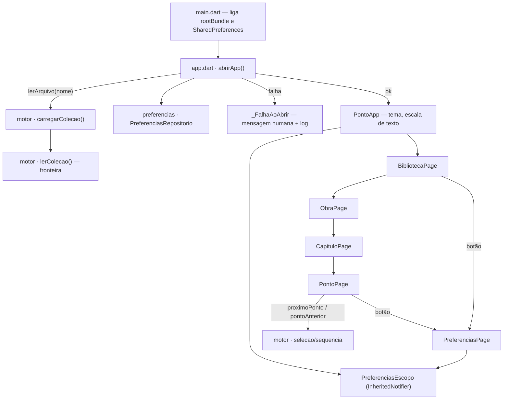

# Ler (v0.2) — Design

**Spec:** `.specs/features/ler/spec.md`
**Status:** Approved (delegado — o usuário pediu o fluxo completo sem pausas; ver Rulings no fim)
**Decisões de projeto que esta feature cria:** AD-002 … AD-006 em `.specs/STATE.md`

---

## Architecture Overview

Duas camadas, já fixadas pelo ADR-001 e por `docs/dominios.md`: o **motor** (Dart puro) sabe ler,
validar e navegar a coleção; o **app** só faz I/O (assets, preferências, log) e desenha telas.
A v0.2 engrossa o motor (fronteira firme, sequência, índice) e acrescenta quatro telas, um tema
e as preferências de leitura.



Texto equivalente: `main` → `abrirApp` carrega coleção (via porta do motor) e preferências →
falha vira tela humana; sucesso monta `PontoApp`, que aplica tema/escala e abre a Biblioteca.
Biblioteca → Obra → Capítulo → Ponto; o Ponto pede anterior/próximo ao motor. Biblioteca e
Ponto abrem as preferências, que vivem num `InheritedNotifier` no topo do app.

---

## Code Reuse Analysis

### Existing Components to Leverage

| Component | Location | How to Use |
| --- | --- | --- |
| `lerColecao`, `PontoId`, `Obra`, `Capitulo`, `Ponto` | `packages/ponto_motor/lib/src/colecao/` | Estender: campos de intervalo, validação, `pontosDoCapitulo` |
| `obterPonto` | `packages/ponto_motor/lib/src/selecao/obter_ponto.dart` | Manter; `primeiroPonto` sai (fica sem uso com A1) |
| Fixture do motor | `packages/ponto_motor/test/fixtures.dart` | Estender com os cenários de A13 |
| Teste de contrato | `packages/ponto_motor/test/livros_contract_test.dart` | Passar a usar `carregarColecao` |
| `PontoPage` (v0.1) | `apps/ponto_mobile/lib/colecao/ponto_page.dart` | Evoluir: anterior/próximo, tipografia, botão de preferências |
| Padrão de store defensivo | `02_pathling-game/.../shared_prefs_progress_store.dart` | Mesmo formato: leitura que nunca lança, ausente/inválido → padrão |
| `validar.py` | `livros/validar.py` | Acrescentar duas invariantes |

### Integration Points

| System | Integration Method |
| --- | --- |
| `livros/*.json` | Empacotados por symlink (v0.1); lidos pelo app só através de `carregarColecao` |
| Armazenamento local | `shared_preferences` — duas chaves de texto |
| Fonte Literata | `assets/fonts/` + `flutter: fonts:` no pubspec — empacotada, sem rede |

---

## Components

### Motor — fronteira (`colecao/ler_colecao.dart`) · BASE-01..03
- **Purpose:** transformar JSON decodificado em `Colecao` válida, ou lançar `FormatException`.
- **Interfaces:** `Colecao lerColecao(Map<String, Object?> colecaoJson, Map<String, Object?> obrasJson)` (inalterada).
- **Mudanças:** campos opcionais lidos por helpers que conferem o tipo (`_textoOpcional`,
  `_inteiroOpcional`) e lançam `FormatException` com `obra/campo`; ids de obra conferidos um a um;
  `numero` repetido e `capituloNumero` desconhecido recusados; `pontoInicial`/`pontoFinal` lidos.
- **Reuses:** padrões de map pattern da v0.1.

### Motor — carregamento (`colecao/carregar_colecao.dart`, novo) · BASE-04
- **Purpose:** ser o único dono do formato de arquivos de `livros/`.
- **Interfaces:** `Future<Colecao> carregarColecao(Future<String> Function(String arquivo) lerArquivo)` —
  pede `colecao.json` e depois `<obra>.json` para cada obra listada; decodifica e chama `lerColecao`.
- **Dependencies:** `dart:convert` (puro). I/O injetado — o motor continua sem I/O.

### Motor — modelo (`colecao/colecao.dart`) · LER-02, LER-03, LER-06
- `Capitulo` ganha `pontoInicial`, `pontoFinal` (`int?`) e `int? get totalPontos` (nulo se o intervalo
  estiver incompleto).
- `Obra.pontosDoCapitulo(int numero)` → `List<Ponto>` em `ordem`.
- `Referencia` deixa de ser record e vira `final class` com `String get texto` — dono único do
  formato "Obra, capítulo X, ponto N" (sai de `ponto_page.dart`).
- Buscas lineares viram `where(...).firstOrNull` (achado R7).

### Motor — sequência (`selecao/sequencia.dart`, novo) · LER-07..09
- **Interfaces:** `Ponto? proximoPonto(Colecao colecao, PontoId id)` · `Ponto? pontoAnterior(Colecao colecao, PontoId id)`.
- **Regra:** posição em `obra.pontos` (já em `ordem`); ±1; fora da lista ou id desconhecido → `null`.
  Não atravessa obras (A2); só pontos disponíveis (A3).

### App — tema (`lib/tema.dart`, novo) · TIPO-01, TIPO-02
- **Purpose:** tokens de cor provisórios (azul-noite, marfim, terracota, âmbar) e `ThemeData` claro/escuro
  com Literata nos estilos de leitura (`bodyLarge` para o texto do ponto, títulos).
- **Interfaces:** `ThemeData temaClaro()`, `ThemeData temaEscuro()`, `class CoresDeLeitura` (tokens nomeados).

### App — preferências (`lib/preferencias/`) · PREF-01..04
- `preferencias.dart` — `enum Tema { sistema, claro, escuro }` (+ `ThemeMode`), `enum TamanhoTexto
  { pequeno(0.9), medio(1.0), grande(1.15), muitoGrande(1.3) }`, `final class Preferencias` (valor imutável).
- `preferencias_repositorio.dart` — `Future<Preferencias> ler()` (nunca lança; inválido → padrão) e
  `Future<void> gravar(Preferencias)`; chaves `preferencias.tema` e `preferencias.tamanhoTexto` com o
  `name` do enum.
- `preferencias_controller.dart` — `PreferenciasController extends ValueNotifier<Preferencias>`:
  `mudarTema`, `mudarTamanho` atualizam o valor e gravam. `PreferenciasEscopo extends
  InheritedNotifier<PreferenciasController>` com `of(context)`.
- `preferencias_page.dart` — duas escolhas (tema, tamanho) com `SegmentedButton`/`RadioGroup` nativos.

### App — telas (`lib/colecao/`) · LER-01..09
- `biblioteca_page.dart` — lista `colecao.obras` em ordem; toque → `ObraPage`. Botão de preferências.
- `obra_page.dart` — lista `obra.capitulos`: "N · Título" (ou "Capítulo N") + "M pontos" quando `totalPontos != null`.
- `capitulo_page.dart` — `obra.pontosDoCapitulo(n)`; item = número + prévia (2 linhas); vazio → mensagem de A5.
- `ponto_page.dart` — `StatefulWidget` que guarda o `PontoId` atual e troca o conteúdo no lugar
  (sem empilhar rotas: "voltar" sempre retorna ao capítulo). Rolagem volta ao topo a cada troca
  (`key` por ponto). "Anterior"/"Próximo" só aparecem quando o motor devolve um ponto.

### App — abertura (`lib/app.dart`, `lib/main.dart`) · BASE-05, PREF-01/02
- `Future<Widget> abrirApp({required Future<Colecao> Function() carregarColecao, required PreferenciasRepositorio repositorio})` —
  carrega antes do primeiro quadro (a splash nativa cobre); exceção → `FlutterError.reportError` + `_FalhaAoAbrir`.
- `PontoApp` — `ListenableBuilder` sobre o controller: `themeMode`, `theme`, `darkTheme`, e
  `builder:` que multiplica `MediaQuery.textScaler` pelo fator do tamanho escolhido.
- `main.dart` — só liga as dependências reais (`rootBundle`, `SharedPreferences.getInstance()`).

---

## Data Models

```dart
final class Capitulo { int numero; String? slug; String? titulo; int? pontoInicial; int? pontoFinal;
                       int? get totalPontos; }
final class Referencia { String obra; String? capitulo; int numero; String get texto; }
enum Tema { sistema, claro, escuro }
enum TamanhoTexto { pequeno(0.9), medio(1.0), grande(1.15), muitoGrande(1.3); final double fator; }
final class Preferencias { Tema tema; TamanhoTexto tamanhoTexto; static const padrao = Preferencias(sistema, medio); }
```

**Relationships:** `Colecao 1—N Obra 1—N Capitulo`, `Obra 1—N Ponto` (por `capituloNumero`, agora
garantido existente). `Preferencias` não se relaciona com conteúdo.

---

## Testing Seams

| Seam | Existing or New | What a test asserts through it | Reuses |
| --- | --- | --- | --- |
| `lerColecao(...)` | Existing | tipos errados, duplicados, capítulo desconhecido → `FormatException`; intervalos lidos | `test/fixtures.dart` |
| `carregarColecao(lerArquivo)` | **New** — é a porta de BASE-04; o teste injeta um mapa nome→conteúdo | arquivos pedidos e coleção montada | contrato com `livros/` real |
| `proximoPonto` / `pontoAnterior` / `pontosDoCapitulo` / `totalPontos` / `Referencia.texto` | New funções públicas no seam existente (API do motor) | sequência, pontas, buracos, contagem, formato | fixture do motor |
| `validar(caminho, estrito)` em `validar.py` | Existing função; **new** harness `unittest` (stdlib) | erros de duplicado e capítulo desconhecido | arquivos temporários |
| `PreferenciasRepositorio` sobre `SharedPreferences` | New — `setMockInitialValues` é o seam oficial do pacote | gravar→ler, inválido→padrão | padrão do pathling |
| Telas construídas com `Colecao` de teste | Existing padrão (teste de widget da v0.1) | listas, navegação, estados vazios, pontas | helper `montarTela` em `test/` |
| `abrirApp(carregarColecao:, repositorio:)` | **New** — único jeito de testar falha de abertura sem tocar em `rootBundle` | mensagem humana, sem texto da exceção | — |

---

## Error Handling Strategy

| Error Scenario | Handling | User Impact |
| --- | --- | --- |
| JSON malformado / campo de tipo errado / duplicado / capítulo desconhecido | `FormatException` no motor; `abrirApp` captura, reporta ao log | Tela de A12 |
| Arquivo de obra ausente | `lerArquivo` lança; mesmo caminho | Tela de A12 |
| Preferência gravada inválida | `ler()` devolve o padrão daquele campo | Abre no padrão, sem aviso |
| Falha ao gravar preferência | `gravar` propaga; controller já trocou o valor em memória — sessão segue | Escolha vale na sessão; pode não persistir |
| Capítulo sem pontos | Estado vazio (A5) | Mensagem serena |
| `PontoId` desconhecido em anterior/próximo | `null` → controle não aparece | Nada |

---

## Risks & Concerns

| Concern | Location | Impact | Mitigation |
| --- | --- | --- | --- |
| Achados R1/R2: `cast<String>()` e `as String?` lançam `TypeError`, não `FormatException` | `ler_colecao.dart:19,64-65` | Erro de dado escapa do contrato da fronteira | T3 |
| R3: número repetido sobrescreve em silêncio; capítulo inexistente aceito (motor **e** validar.py) | `colecao.dart:51`, `validar.py` (range check usa `.get(..., (None, None))`) | Referência errada ou ponto invisível | T2, T3 |
| R4: formato de `livros/` conhecido em dois lugares; app lê `colecao.json` sem validar | `carregar_colecao.dart:12-14` (app) e teste de contrato | Divergência; `TypeError` fora da fronteira | T4 |
| R5/R6: exceção crua na tela; abertura em branco | `main.dart:31,34` | Jargão ao leitor | T16 |
| R8: análise estática no mínimo | `analysis_options.yaml` (×2) | Casts implícitos passam | T1 |
| R9: `primeiroPonto` fica sem uso | `obter_ponto.dart:9-15` | Código morto | T16 |
| R10: teste da v0.1 chama-se `ponto_page_test` mas testa a abertura | `apps/ponto_mobile/test/colecao/ponto_page_test.dart` | Nome engana | T16 (vira teste de abertura) |
| R11: formato da referência na UI, regra de domínio | `ponto_page.dart:42-45` | Duas fontes quando o compartilhar chegar (v0.4) | T5 |
| Fonte variável: peso via `FontWeight` depende da versão do Flutter | `tema.dart` | Títulos sem negrito | Docs do Flutter confirmam o mapeamento; conferir no UAT em aparelho |
| Escala do sistema × "Muito grande" pode passar de 2,5× | `ponto_page.dart` | Texto enorme | Página rola; edge case no spec |
| Contraste só testado nos tokens, não em cada combinação de widget | `tema.dart` | Combinação ruim passa | Aceito na v0.2; auditoria a11y é gate da v1.0 → **TD-003** |
| Sem teste em aparelho real (não há dispositivo/emulador aqui) | — | Comportamento nativo não visto | APK no build gate; UAT no aparelho do Gustavo → **TD-004** |

---

## Tech Decisions

| Decision | Choice | Rationale |
| --- | --- | --- |
| Estado global | `ValueNotifier` + `InheritedNotifier`, sem pacote | Uma peça de estado compartilhado; Flutter já resolve → **AD-002** |
| Carregamento | Porta `lerArquivo` no motor | Motor sem I/O e dono do formato → **AD-003** |
| Rastreio teste↔requisito | Nome do teste começa com o ID (`'LER-07: …'`) | `dart test` não exige config de tag; busca por ID acha o teste → **AD-004** |
| Preferências | `shared_preferences`, chave por campo com `enum.name` | Não sensível; dado sensível só no banco cifrado (v0.3) → **AD-005** |
| Navegação | `Navigator` + `MaterialPageRoute`, sem pacote de rotas | Sem deep link ainda → **AD-006** (revisar quando deep link `ponto:` for puxado) |
| Página do ponto | Troca o ponto no lugar, sem empilhar rotas | "Voltar" sempre leva ao capítulo, não a 30 pontos atrás |
| Abertura | Carregar antes de `runApp` | A splash nativa cobre ~ms de leitura de assets; dispensa estado "carregando" no app |

---

## Rulings

- Ruling: design aprovado sem pausa para confirmação — o usuário pediu "spec-driven completo" de
  uma vez — custo se errado: retrabalho de telas; mitigado pelo UAT no fim.
- Ruling: A1–A12 decididos pelo agente e registrados no spec — custo se errado: ajuste de UX,
  baixo (telas pequenas, tudo testado).
