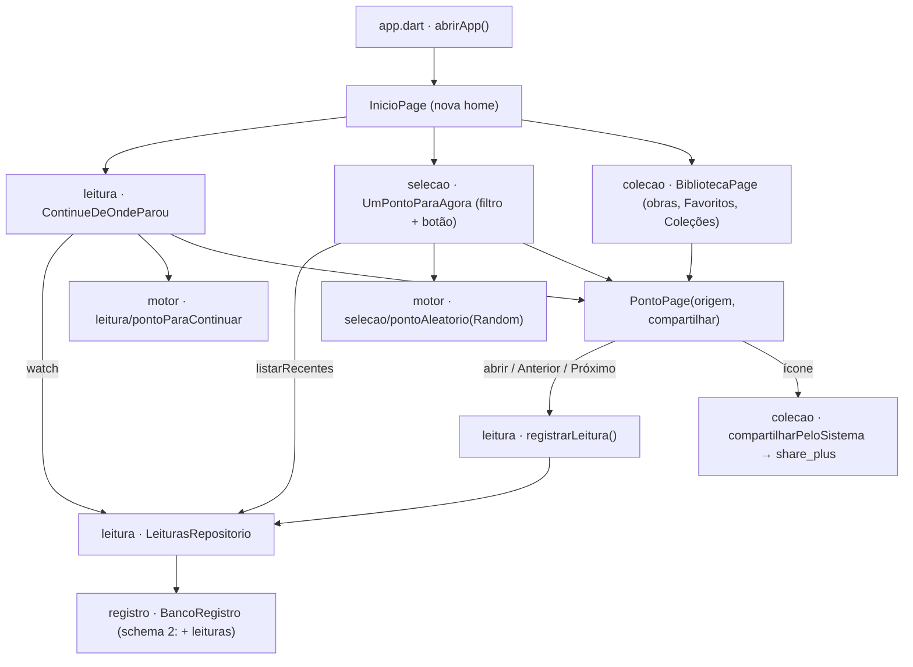

# Voltar (v0.4) — Design

**Spec:** `.specs/features/voltar/spec.md`
**Status:** Approved (delegado — "Faça o v0.4", mesmo acordo de fluxo sem pausas da v0.2/v0.3; ver Rulings no fim)
**Decisões de projeto que esta feature cria:** AD-010, AD-011 em `.specs/STATE.md`

---

## Architecture Overview

O **motor** ganha a pasta `leitura/` (origem da leitura e "para onde o continue aponta") e, em
`selecao/`, o `pontoAleatorio`. Ambos são funções puras: recebem a `Colecao`, listas de `PontoId` já
consultadas e — no aleatório — a fonte de aleatoriedade. O **app** ganha a tabela `leituras` no banco
cifrado do registro (schema 1 → 2), um repositório em `lib/leitura/`, a **tela inicial** e o botão de
compartilhar na página do ponto.



Texto equivalente: a home monta três blocos. O continue assina um stream dos últimos pontos lidos em
sequência e pede ao motor o primeiro que existe na coleção. O aleatório, no toque, consulta os
recentes e pede ao motor um ponto. Toda entrada abre `PontoPage` dizendo a origem; a página grava uma
leitura ao abrir e a cada Anterior/Próximo. Compartilhar passa só `Referencia.texto` para a folha do
sistema.

### Abordagens consideradas (Complex)

| | Abordagem | Prós | Contras |
| --- | --- | --- | --- |
| **A ✅** | Log de eventos `leituras` no banco cifrado; regras (sequência, janela, sorteio, encolher) puras no motor; consultas limitadas no app; telas assinam `watch()` (AD-007) | Regra 4 literal (progresso derivado de eventos); v1.3 já tem o histórico; motor testável sem banco | Uma migração de schema; consulta agrupada cresce com o histórico (Risks) |
| B | Estado em vez de evento: uma linha "último lugar" + um anel com os 10 recentes | Consultas triviais, sem agrupamento | Contradiz a regra 4; a v1.3 nasceria sem histórico; a regra "em sequência" vira código de escrita espalhado |
| C | Porta `Leituras` no motor + implementação em memória para testes | Motor "completo" | Mesmo motivo da rejeição na v0.3: o fake diverge do SQL real (agrupamento, ordem) |

### Perspective sweep

- **Estrutura** — motor `leitura/` e `selecao/` sem I/O; app `leitura/` (repositório, gravar, widget
  do continue), `selecao/` (widget do aleatório), `colecao/` (compartilhar), home em `lib/inicio_page.dart`
  junto da casca (`app.dart`): a home não é domínio, compõe três. `PontoPage` só chama `registrarLeitura`
  e `compartilhar` — a regra mora fora.
- **Integração** — streams do drift para o continue; o aleatório lê os recentes uma vez por toque
  (`Future`). Folha de compartilhamento atrás de `typedef Compartilhar` (o plugin não roda em teste).
- **Dados** — tabela `leituras` (id autoincremento, `pontoId`, `lidoEm` UTC ISO-8601, `origem` por
  nome do enum). "Mais recente" = maior `id` (AD-010, A16). Migração 1 → 2 numa transação, testada
  contra o schema 1 congelado (AD-011).
- **Segurança** — leitura é dado sensível (A5): só no banco cifrado; falha vai ao log só pelo tipo
  (AD-009). Compartilhar leva só a referência — nunca texto do ponto nem reflexão (regra 5, `modelo.md` §7).
- **Infra & ops** — dependência nova `share_plus` (13.3.1 resolve no pub). O plugin pede AGP ≥ 8.12.1
  e o projeto está no 8.11.1: o APK de debug é gerado na tarefa do compartilhar; se falhar, sobe o AGP
  para 8.12.x (uma linha em `settings.gradle.kts`). Sem servidor, sem rede própria do app.
- **Domínio** — `OrigemDaLeitura` ganha `continuacao` e `favoritos` (A9) e o `modelo.md` §4 muda junto;
  "continue" passa a ser "última leitura **em sequência**" (A7). Nenhum id de obra no app (regra 1):
  o filtro lista `colecao.obras`.

---

## Code Reuse Analysis

### Existing Components to Leverage

| Component | Location | How to Use |
| --- | --- | --- |
| `Registro` + `agora` injetável | `apps/ponto_mobile/lib/registro/registro.dart` | Ganha `leituras`; o relógio de teste continua sendo o mesmo parâmetro |
| `BancoRegistro` | `lib/registro/banco_registro.dart` | Ganha a tabela, `schemaVersion: 2` e o `onUpgrade` |
| `lerPontoIdGravado` | `lib/registro/ponto_id_gravado.dart` | Linha estragada ignorada no continue e nos recentes |
| `relatarFalhaNoRegistro` | `lib/registro/falha_no_registro.dart` | Falha de gravar/consultar leitura (AD-009) |
| `RegistroEscopo` | `lib/registro/registro_escopo.dart` | Home e página pegam o `Registro?` daqui |
| `abrirRegistro` | `lib/registro/abrir_registro.dart` | Sem mudança: o `SELECT 1` já força a migração; falha → `null` (AC-07) |
| `Referencia.texto` | `packages/ponto_motor/lib/src/colecao/colecao.dart` | Texto exato do compartilhamento e do subtítulo do continue |
| `PontoGuardadoTile` | `lib/registro/ponto_guardado_tile.dart` | Ganha `origem` (`favoritos` ou `colecao`) |
| Harness de teste | `test/montar_tela.dart`, `test/registro/banco_de_teste.dart`, `test/colecao_de_teste.dart`, `test/infra/cofre_de_teste.dart` | Banco em memória, relógio, tela estreita, cofre falso |

### Integration Points

| System | Integration Method |
| --- | --- |
| `abrirApp` | `inicio:` passa a ser `InicioPage(colecao)` no lugar de `BibliotecaPage` |
| `CapituloPage` | abre `PontoPage(origem: biblioteca)` |
| `FavoritosPage` / `ColecaoPessoalPage` | passam `origem` ao `PontoGuardadoTile` |
| Banco cifrado | `onUpgrade` 1 → 2 dentro de `transaction()`; cifra e chave sem mudança (ADR-002) |
| Folha do sistema | `SharePlus.instance.share(ShareParams(text: …))` dentro de `compartilharPeloSistema` |

---

## Components

### Motor — origem da leitura (`packages/ponto_motor/lib/src/leitura/leitura.dart`) · LEI-02, CONT-01
- **Purpose:** o conjunto fechado de origens e qual delas é leitura em sequência.
- **Interfaces:**
  - `enum OrigemDaLeitura { biblioteca, continuacao, aleatorio, favoritos, colecao }` com `bool emSequencia`
    (`true` só em `biblioteca` e `continuacao` — A7).
- **INVARIANT:** o nome de cada valor é gravado no banco; renomear exige migração.

### Motor — continue (`packages/ponto_motor/lib/src/leitura/continuar.dart`) · CONT-01, CONT-05
- **Interfaces:** `Ponto? pontoParaContinuar(Colecao colecao, Iterable<PontoId> lidosEmSequencia)` —
  recebe do mais novo para o mais antigo; devolve o primeiro que existe na coleção, ou nulo.

### Motor — um ponto para agora (`packages/ponto_motor/lib/src/selecao/ponto_aleatorio.dart`) · AGORA-01..05
- **Interfaces:**
  - `const janelaDeRecentes = 10;`
  - `Ponto? pontoAleatorio(Colecao colecao, {required Random aleatorio, String? obra, Iterable<PontoId> recentes = const []})`
- **Regra:** universo = pontos da obra filtrada (ou de todas, na ordem da coleção e de leitura);
  janela = os primeiros `janelaDeRecentes` **distintos** de `recentes`; candidatos = universo fora da
  janela; se vazio, a janela perde o mais antigo até sobrar candidato. Sorteio: `candidatos[aleatorio.nextInt(candidatos.length)]`.
  Nulo só com universo vazio.

### App — tabela `leituras` (`apps/ponto_mobile/lib/leitura/tabela_leituras.dart`) · LEI-01
- Declarada no domínio `leitura`, registrada em `@DriftDatabase` de `BancoRegistro` (um banco cifrado só).

### App — banco (`lib/registro/banco_registro.dart`) · LEI-06, LEI-07
- `schemaVersion: 2`; `onUpgrade: (m, de, para) => transaction(() async { if (de < 2) await m.createTable(leituras); })`.

### App — repositório (`lib/leitura/leituras_repositorio.dart`) · LEI-01..03, CONT-01..05, AGORA-02/03
- **Interfaces:**
  - `Future<void> registrar(PontoId ponto, OrigemDaLeitura origem)` — `lidoEm = agora().toUtc()`.
  - `Stream<List<PontoId>> observarLidosEmSequencia({required int limite})` — distintos, do mais novo
    (maior `id`) para o mais antigo, só origens `emSequencia`.
  - `Future<List<PontoId>> listarRecentes({required int limite})` — idem, qualquer origem.
  - Ambas: `GROUP BY pontoId ORDER BY MAX(id) DESC LIMIT limite`; linha estragada ignorada.
- Exposto como `registro.leituras`.

### App — gravar leitura (`lib/leitura/registrar_leitura.dart`) · LEI-05
- `Future<void> registrarLeitura(Registro? registro, PontoId ponto, OrigemDaLeitura origem)` — nulo
  não faz nada; qualquer erro → `relatarFalhaNoRegistro(…, 'ao registrar uma leitura')`; nunca lança.

### App — página do ponto (`lib/colecao/ponto_page.dart`) · LEI-01..05, COMP-01..03
- Novos parâmetros: `required OrigemDaLeitura origem`, `Compartilhar compartilhar = compartilharPeloSistema`.
- Grava a primeira leitura em `didChangeDependencies`, uma vez só (guarda de estado — AC-04); `_ir` grava
  com `biblioteca`. `IconButton(Icons.share_outlined, tooltip: 'Compartilhar referência')` na barra.

### App — compartilhar (`lib/colecao/compartilhar_referencia.dart`) · COMP-01, COMP-02
- `typedef Compartilhar = Future<void> Function(String texto);`
- `Future<void> compartilharPeloSistema(String texto)` → share_plus.
- Falha: SnackBar "Não foi possível compartilhar." + log com `FalhaAoCompartilhar(tipo)`.

### App — continue (`lib/leitura/continue_de_onde_parou.dart`) · CONT-01..06
- `StatefulWidget`; stream criado no `initState` (AD-007). Sem registro, esperando, vazio ou sem ponto
  existente → `SizedBox.shrink()`. Senão `ListTile(title: 'Continue de onde parou', subtitle: referência)`
  → `PontoPage(origem: continuacao)`.

### App — aleatório (`lib/selecao/um_ponto_para_agora.dart`) · AGORA-01..06
- Estado: obra escolhida (`String?`, nulo = todas). Opções: `ChoiceChip` num `Wrap` ("Todas as obras" +
  `colecao.obras.where((o) => o.pontos.isNotEmpty)`). Botão `FilledButton('Um ponto para agora')`:
  `listarRecentes(limite: janelaDeRecentes)` (sem registro ou erro → `[]`, erro ao log pelo tipo) →
  `pontoAleatorio` → `PontoPage(origem: aleatorio)`.
- Recebe `Random aleatorio` por construtor (regra 6).

### App — tela inicial (`lib/inicio_page.dart`) · INI-01..03
- `Scaffold(appBar: título da coleção + BotaoPreferencias)`, `ListView`: continue, aleatório, `ListTile('Biblioteca')`.
- `InicioPage({required Colecao colecao, Random? aleatorio})` — padrão `Random()`.

---

## Data Models

```dart
// lib/leitura/tabela_leituras.dart
@DataClassName('LinhaDeLeitura')
class Leituras extends Table {
  // INVARIANT: a ordem de gravação decide o "mais recente" (AD-010) — nunca lidoEm.
  IntColumn get id => integer().autoIncrement()();
  TextColumn get pontoId => text()();
  DateTimeColumn get lidoEm => dateTime()();
  TextColumn get origem => textEnum<OrigemDaLeitura>()();
}
```

**Relationships:** ancora em `PontoId.toString()` (regra 2), como reflexões e favoritos; sem chave
estrangeira (o ponto vive na coleção de conteúdo, não no banco). Sem índice extra: a ordem é a do `id`.

---

## Testing Seams

| Seam | Existing or New | What a test asserts through it | Reuses |
| --- | --- | --- | --- |
| `pontoAleatorio`, `pontoParaContinuar`, `OrigemDaLeitura` (API pública do motor) | New — a regra é do motor (AD-003, regra 6) | AC-09 (motor), AC-13, AC-15..18 com `Random` falso enumerando todas as saídas | `package:test`, coleção montada no teste |
| `Registro(banco, agora:)` → `registro.leituras` | Existing | AC-01..03, AC-05(c) (relógio que lança), AC-11 | `banco_de_teste.dart`, `RelogioDeTeste` |
| `montarTela` + `PontoPage`/`InicioPage` | Existing | AC-02..05, AC-09..10, AC-12..14, AC-19..26 | `montar_tela.dart`, `testWidgetsComRegistro` |
| `abrirApp(...)` | Existing | AC-21, AC-22 (home é a primeira tela; favorito em 3 toques) | `app_test.dart` |
| `abrirRegistro(pasta:, cofre:)` sobre arquivo real | Existing | AC-06, AC-07, AC-08 | `cofre_de_teste.dart`, `banco_cifrado_test.dart` |
| Schema 1 congelado (`test/registro/schema_v1.dart`) | New — AD-011: sem ele não há como criar um arquivo "da v0.3" depois que o código mudar | AC-06, AC-07; schema migrado = schema novo | `sqlite_master` do schema 1 capturado antes da mudança |
| `Random aleatorio` em `InicioPage`/`UmPontoParaAgora` | New — regra 6 exige aleatoriedade por parâmetro | AC-15, AC-19 | — |
| `Compartilhar compartilhar` em `PontoPage` | New — o plugin nativo não roda em teste de widget | AC-24, AC-25 | — |

---

## Error Handling Strategy

| Error Scenario | Handling | User Impact |
| --- | --- | --- |
| Registro indisponível | `registrarLeitura` não faz nada; continue some; aleatório sem recentes | Lê normalmente; nenhum aviso na home (A6) |
| Gravar leitura falha (banco ou outro erro) | `relatarFalhaNoRegistro` (só o tipo) | Nenhum (A21) |
| Consulta dos recentes falha | `[]` + log só do tipo | Aleatório funciona sem excluir recentes |
| Stream do continue dá erro | `StreamBuilder` com erro → `SizedBox.shrink()`; o erro do stream vai ao log pelo tipo | Continue some |
| Migração 1 → 2 falha | Transação desfeita; `abrirRegistro` → `null` (já existente) | Registro indisponível (AC-04 da v0.3); livros abrem |
| Folha de compartilhamento falha | SnackBar + `FalhaAoCompartilhar(tipo)` no log | "Não foi possível compartilhar." |

---

## Risks & Concerns

| Concern | Location | Impact | Mitigation |
| --- | --- | --- | --- |
| Drift **não** envolve `onUpgrade` numa transação (doc: "you can wrap it in a transaction") | `lib/registro/banco_registro.dart` `migration` | Migração pela metade deixaria schema inconsistente | `transaction()` explícito + AC-07 prova `user_version` = 1 e linhas intactas depois da falha |
| `share_plus` 13 pede AGP ≥ 8.12.1; o projeto usa 8.11.1 | `android/settings.gradle.kts:22` | Build Android pode falhar | `flutter build apk --debug` na tarefa do compartilhar; se falhar, subir AGP para 8.12.x |
| Consulta agrupada percorre todo o histórico | `leituras_repositorio.dart` | Cresce com os anos (≈180 mil linhas a 50 leituras/dia por 10 anos) | Aceito: varredura de poucas dezenas de ms em isolate à parte. **TD-007** com gatilho |
| `LER-01` (v0.2) afirma que o app abre na biblioteca | `test/app_test.dart:92` | O teste falha por mudança deliberada | Substituído por INI-01 (A4) no mesmo commit da home — não é teste enfraquecido |
| Ainda nunca rodou num aparelho (TD-004) | — | Migração, share e home sem prova nativa | UAT da v0.4 entra no TD-004 |
| Sinal anterior não confirmado (candidatas L-001, L-006, L-007, L-009) | `.specs/LESSONS.md` | Mutantes que sobreviveram na v0.2/v0.3 | Aplicadas no plano de teste: erro não-banco (AC-05c), linhas irmãs intactas (AC-06), tudo-ou-nada por objeto conflitante (AC-07), prova nos bytes (AC-08) |

---

## Tech Decisions (only non-obvious ones)

| Decision | Choice | Rationale |
| --- | --- | --- |
| "Mais recente" | Maior `id` autoincremento | Relógio pode voltar (A16); `AUTOINCREMENT` nunca reusa id → **AD-010** |
| Teste de migração | Schema N−1 congelado em `test/registro/schema_vN-1.dart` + "migrado = novo" | Prova o caminho real de quem já tem dados; padrão para toda migração futura → **AD-011** |
| Origem gravada | `textEnum` do drift (nome do valor) | Legível no arquivo, sem tabela de códigos; INVARIANT no enum |
| Onde fica a home | `lib/inicio_page.dart`, ao lado de `app.dart` | Compõe três domínios; não é domínio (`dominios.md`) |
| Primeira leitura | `didChangeDependencies` com guarda | `RegistroEscopo.of` não pode ser chamado no `initState`; a guarda impede gravar a cada troca de tema (AC-04) |
| Filtro de obra | `ChoiceChip` num `Wrap` | Quebra linha a 320 px com texto grande (AC-23); leitor de tela anuncia seleção |
| Log da falha de compartilhar | `FalhaAoCompartilhar` próprio, não `FalhaNoRegistro` | O compartilhar não é do registro; o nome do erro no log precisa dizer a verdade |

---

## Rulings (delegados)

O usuário pediu "Faça o v0.4" depois de decidir A1–A6; pelo acordo das versões anteriores, o agente
decide o resto e registra. Revisar no fechamento:

1. **A7 — continue só pela leitura em sequência.** É a decisão de produto mais sensível do spec.
2. **A9 — duas origens novas no `modelo.md`** (`continuacao`, `favoritos`).
3. **Abordagem A** (log de eventos) sobre B (estado) — B contradiz a regra 4.
4. **Três seams novos** (motor, `Random`, `Compartilhar`) e o schema congelado.
