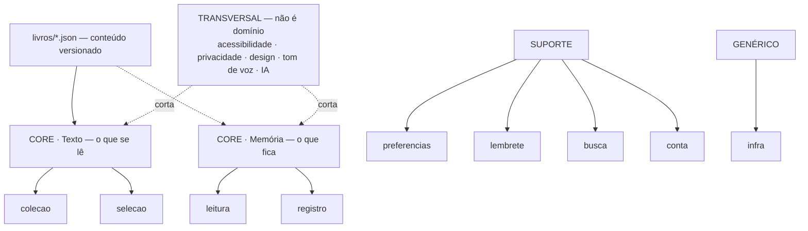

# Domínios — Ponto do Caminho

> **Versão** 0.1 · out/2026. Mapa estrutural do produto: **quais** domínios existem, em que camada,
> e **onde** moram no código. Espelha (e dita) a organização do código.
>
> Este doc responde **"como o produto se divide em partes desacopladas?"**. Não lista ideias — isso é
> [`backlog.md`](backlog.md), organizado pelos mesmos domínios. A **ordem** é
> [`roadmap.md`](roadmap.md). O **modelo** (campos, operações, vocabulário da interface) é
> [`modelo.md`](modelo.md) — dono único dos termos.

---

## Vocabulário estrutural (leia primeiro)

| Camada | DDD | O que é | Vira pasta? |
| --- | --- | --- | --- |
| **Core** | core domain | O diferencial, agrupado por pilar do produto | ✅ um domínio = uma pasta |
| **Suporte** | supporting subdomain | O produto precisa, mas não é a cara de nenhum pilar | ✅ |
| **Genérico** | generic subdomain | Commodity técnica, sem regra de negócio | ✅ (`infra/`) |
| **Transversal** | cross-cutting concern | Corta vários domínios. **Não é domínio.** | ❌ nunca |

- **Domínio nasce** quando uma ideia tem **nome + usuário + problema** e não cabe em nenhum
  existente. Antes disso, mora na Incubadora do [`backlog.md`](backlog.md).
- **Nomes de domínio em PT-BR sem acento** (`colecao`, `selecao`) — a língua do negócio e do
  schema em `livros/`. Estrutura, verbos e tipos em EN (`getPonto`, `isRead`).

**Código** (Flutter + Dart — [ADR-001](adr/001-stack-mobile-flutter.md)): o motor é um **pacote
Dart puro**, sem Flutter nem I/O, com uma pasta por domínio; o app só orquestra telas e faz I/O.

```
packages/ponto_motor/lib/src/<dominio>/  ← colecao, selecao, leitura, registro (lógica pura)
apps/ponto_mobile/lib/<dominio>/         ← telas + I/O (assets, banco, notificação) por domínio
livros/                                  ← dado de conteúdo; o app o empacota via symlink
```

---

## Diagrama



```
CORE · Texto      colecao (corpus) · selecao (qual ponto mostrar)
CORE · Memória    leitura (o que foi lido) · registro (o que o leitor guardou)
SUPORTE           preferencias · lembrete (v1.1) · busca (v1.2) · conta (v2.0)
GENÉRICO          infra — banco local cifrado, chave, adaptador de notificação
TRANSVERSAL       acessibilidade · privacidade · design/tipografia · tom de voz · IA — nunca pasta
```

---

## As 6 regras de fronteira

1. **O motor não conhece São Josemaría.** *"Trocar a coleção não reescreve o produto."* `selecao`,
   `leitura` e `registro` recebem uma `Colecao`; nenhum id de obra (`caminho`, `sulco`, `forja`)
   aparece fora de `livros/` e de testes. A tentação é um `if obra === 'caminho'` na UI — o lugar
   certo é um campo no dado.
2. **Tudo do leitor se ancora no `PontoId`, nunca em posição.** *"Uma reflexão sobre Caminho 1
   aponta para o mesmo texto daqui a dez anos."* `registro` e `leitura` guardam
   `ponto:<colecao>/<obra>/<numero>` — nunca `ordem`, índice de array ou id interno de banco.
3. **Existem duas "coleções" e elas não se tocam.** `Colecao` (corpus de conteúdo, domínio
   `colecao`) ≠ `ColecaoPessoal` (lista do leitor, domínio `registro`). Na interface, "coleção"
   significa **sempre** a pessoal. Nunca compartilham tipo, tabela nem função.
4. **Progresso é derivado, não gravado.** *"Nenhum estado comunica atraso."* `leitura` grava
   eventos (`Leitura`); progresso, estado do capítulo e "continue de onde parou" são calculados.
   Não existe campo `streak`, `diasSeguidos` ou `meta`.
5. **Reflexão não sai de `registro` sem pedido explícito.** *"Dado pessoal e religioso."* Telemetria
   registra eventos, nunca conteúdo; IA nunca lê reflexões; coleção compartilhada leva só
   `PontoId[]`. A separação é estrutural (tipos distintos), não um checkbox.
6. **`selecao` é determinística onde promete ser.** O ponto do dia é função pura de
   `(data, semente, preferencias)` — nada armazenado, histórico reconstruível. Aleatório e "agora"
   recebem a fonte de aleatoriedade por parâmetro, para serem testáveis.

---

## Core · Texto

> O que se lê. Existe desde a v0.1.

| Domínio | Papel | Código (atual → alvo) | Linguagem que possui |
| --- | --- | --- | --- |
| **colecao** | carregar e expor o corpus versionado | `livros/` + `packages/ponto_motor/lib/src/colecao/` ✅ | Colecao · Obra · Capitulo · Ponto · Tema · PontoId · Referencia · versaoDados |
| **selecao** | decidir qual ponto mostrar | `packages/ponto_motor/lib/src/selecao/` (só `obterPonto`) | obterPonto · proximo/anterior · um ponto para agora · ponto do dia · semente |

## Core · Memória

> O que fica. É aqui que o diferencial se realiza.

| Domínio | Papel | Código (atual → alvo) | Linguagem que possui |
| --- | --- | --- | --- |
| **leitura** | o que foi lido, de onde veio, por onde retomar | — → `ponto_motor/lib/src/leitura/` | Leitura · origem · progresso · continue de onde parou · leituras recentes |
| **registro** | o que o leitor guardou | — → `ponto_motor/lib/src/registro/` | Reflexao/Anotacao · Favorito · ColecaoPessoal |

## Suporte

| Domínio | Papel | Código (alvo) | Linguagem que possui |
| --- | --- | --- | --- |
| **preferencias** | como o leitor quer ler e receber | `ponto_mobile/lib/preferencias/` | tema · tamanho de fonte · obras do dia · dias · horário |
| **lembrete** *(v1.1)* | notificação opcional do ponto do dia | `ponto_mobile/lib/lembrete/` | lembrete · horário · desligado por padrão |
| **busca** *(v1.2)* | reencontrar um ponto | `ponto_motor/lib/src/busca/` | consulta · filtro · resultado = ponto com referência |
| **conta** *(v2.0)* | sincronizar e não perder anos de reflexões | — | conta opcional · sincronização · exportação · exclusão |

## Genérico

| Domínio | Papel | Código (alvo) |
| --- | --- | --- |
| **infra** | banco local cifrado, guarda da chave, adaptador de notificação | `ponto_mobile/lib/infra/` |

---

## Transversal (NÃO são domínios)

- **Acessibilidade** — requisito da v1.0, não melhoria: leitor de tela, contraste, fonte do sistema,
  alvos de toque, reduzir movimento.
- **Privacidade** — regra 5; cifra em repouso; nenhum conteúdo em telemetria.
- **Design / tipografia** — a decisão de maior impacto na leitura; tokens vivem no app, não no motor.
- **Tom de voz** — [`tom-de-voz.md`](tom-de-voz.md) governa toda string visível.
- **IA** — só na v2.0 e só para *encontrar* texto do autor. Nunca explica, parafraseia ou aconselha.

---

## Relação com os outros docs

- **Este doc** = estrutura. [`backlog.md`](backlog.md) = ideias por domínio.
  [`roadmap.md`](roadmap.md) = ordem. [`modelo.md`](modelo.md) = campos, operações e vocabulário.
